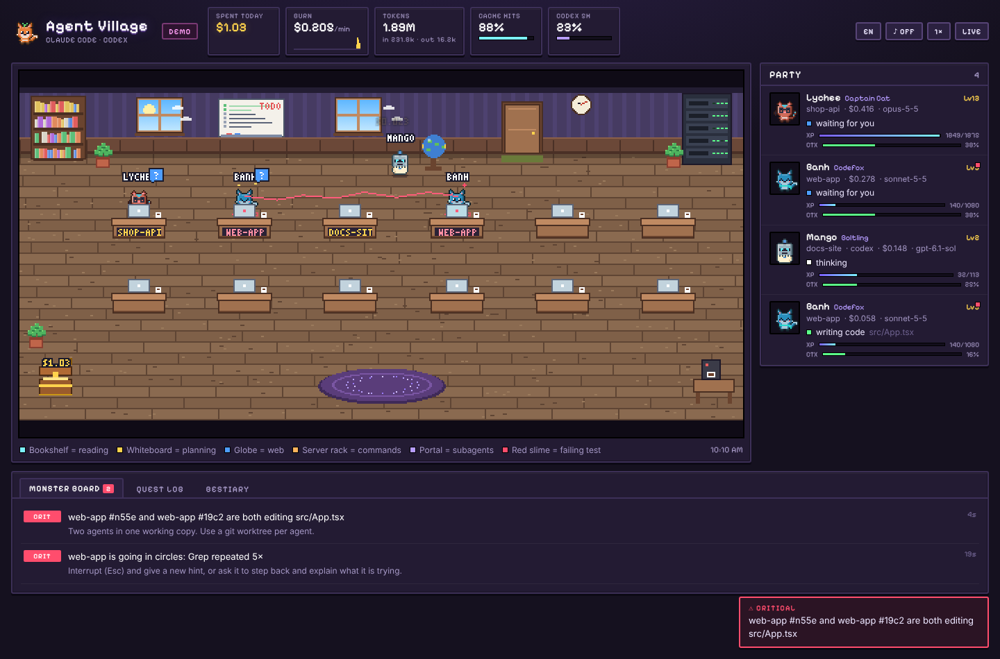
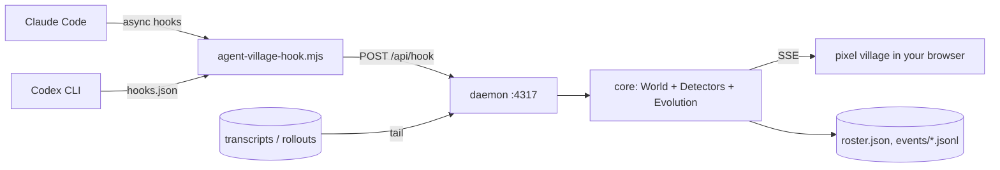

# 🏘 Agent Village

**Watch your coding agents work as a living pixel village.** Every Claude Code session moves into the workshop as a little character. Subagents step out of a portal, carry scrolls back to their lead, and fight bug monsters when tests fail. Coins fly into a treasure chest as tokens are spent. When something goes wrong (a loop, a stuck permission prompt, context about to overflow, two agents editing the same file), you see it before it costs you.

And the villagers **evolve**, but only through good habits: finished work, few loops, and spending less than their own average.



> Claude Code first. Codex CLI support is in **beta**. Local-only, zero runtime dependencies, MIT licensed.

---

## Why

Running agents in parallel creates new problems, and terminal scrollback hides most of them:

| Pain | What usually happens | What the village shows |
|---|---|---|
| A background subagent waits on a permission prompt nobody sees | It hangs silently and you re-run it | A frozen villager with a red `!` and a **critical** alert |
| The agent loops: the same grep, the same failing fix | Tokens burn until you notice | Dizzy stars, a red ring, a "going in circles" alert |
| Context fills up and auto-compacts while subagents report back | Their results get summarised away | An HP bar over each head, and a "compacted during handoff" warning |
| Two sessions edit the same file | The last write wins and work disappears silently | Lightning between the two villagers, and a collision alert |
| Cost is invisible until the bill arrives | `/cost` only shows one session | A live treasury, burn rate, cache-hit ratio, 5-hour block |
| Waiting is boring | You tab away and forget the agent needs you | Villagers walk to the coffee machine when they're waiting for you |

## Quick start (Claude Code)

Requires **Node 18+**. No `npm install` is needed to run it.

```bash
git clone https://github.com/your-org/agent-village
cd agent-village
node bin/agent-village.js start --open      # opens http://127.0.0.1:4317/web/
```

Then connect Claude Code, using **one** of these:

```bash
# A) As a Claude Code plugin (recommended)
claude plugin marketplace add your-org/agent-village
claude plugin install agent-village@agent-village

# B) Or write the hooks into ~/.claude/settings.json yourself
node bin/agent-village.js install claude          # add --project for .claude/settings.local.json
```

Start a new Claude Code session. A new villager walks in through the door.

Useful extras:

```bash
node bin/agent-village.js doctor     # check every part of the setup
node bin/agent-village.js ping       # send a fake mini-session to see the pipeline work
node bin/agent-village.js uninstall claude
```

**Just want to look?** Open `http://127.0.0.1:4317/web/?demo` to see a scripted day in the village. You can also build the single-file demo with `npm i --no-save esbuild && npm run build:demo`, then open `dist/agent-village-demo.html`. Add `&hour=22` to preview night mode and `&lang=vi` for Vietnamese.

### Codex CLI (beta)

```bash
node bin/agent-village.js install codex     # writes ~/.codex/hooks.json
```

Codex only runs hooks you have trusted. Open Codex, run `/hooks`, and trust the agent-village entries. Token usage and rate limits come from `~/.codex/sessions/**/rollout-*.jsonl`.

## What you're looking at


| In the village | Means |
|---|---|
| Villager at its **desk** | Writing code or thinking. A typing glow means edits are happening. |
| **Bookshelf** / **whiteboard** / **globe** / **server rack** | Reading or searching / planning / web / running commands |
| **Portal** on the rug | Subagents arrive and leave here |
| Flying **scroll** (gold → green) | A handoff: task delegated → report returned |
| **Red slime** | A test or build failed. It's defeated when the same kind of command passes again. |
| **Coins → chest** | Spend, priced per model, including cache reads and writes |
| **HP bar** over the head | Context remaining. Yellow means you should plan a compaction; red means compaction is imminent. |
| `!` `?` `…` `ZZ` bubbles | Needs approval · waiting for you · thinking · compacting |
| Red/yellow ring, dizzy stars, sweat drop | Active alert (see the Monster board) |
| **Coffee machine** | The agent has been waiting for you for over 45 seconds |
| Room lighting | Follows your local time; lamps and laptops glow at night |

## Issue detectors

All of these run locally in `core/detectors.js`, and every threshold can be changed in `~/.agent-village/config.json`.

| Detector | Fires when (defaults) | Severity |
|---|---|---|
| `loop` | Same tool + same input ≥3× in the last 8 calls | warn (≥5 → crit) |
| `errorEcho` | Same normalised error message ≥3× in 10 min | warn |
| `stall` | ≥25 tool calls, ≥10 min, ≥$0.50 spent with no file edits (not for read-only roles) | warn |
| `context` | Context ≥65% full | warn (≥80% → crit) |
| `permission` | Main agent blocked on approval >20 s | warn |
| `permissionSub` | A **subagent** blocked on approval | crit |
| `waiting` | Main agent idle, waiting for you >3 min | info |
| `burn` | 5-min average ≥ $1/min | warn (3× → crit) |
| `budget` | Today's spend ≥ `dailyBudgetUsd` (off by default) | crit |
| `collision` | Two unrelated sessions edit the same file within 10 min | crit |
| `compactRisk` | Auto-compaction while subagents are running or just reported back | warn |

Every alert comes with a one-line hint on what to do next.

## Evolution

Each **agent identity** (provider + project + agent type, e.g. `claude:shop-api:code-reviewer`) owns a *familiar* that persists across sessions in `~/.agent-village/roster.json`.

```
xp per finished turn = 10 × work × quality × thrift × cache  +  15 × bugs slain  +  clean bonus
```

- **work**: edits, runs and delegations, capped. Busywork cannot farm XP.
- **quality**: penalised by loops, repeated errors and forced compactions.
- **thrift**: this turn's cost-per-work compared with the familiar's *own* moving average. Spending more never earns more.
- **cache**: a small bonus for good prompt-cache reuse.

**Behaviour decides the species**, and **quality gates decide whether it can evolve**:

| Work style | Species | Egg → Hatchling → Adept → Master (Zen / Alchemist) → Legend |
|---|---|---|
| reading & research | Owl | Hootlet → Scribowl → Sage Owl / Alchemowl → Oracle of Tomes / Golden Grimoire |
| writing code | Fox | Kit → Codefox → Zen Kitsune / Forgefox → Ninetail / Sunforge Kitsune |
| running commands | Bot | Boltling → Gearbot → Zen Golem / Brass Automaton → Synthwarden / Gilded Colossus |
| web & tools | Bunny | Hopper → Scoutbun → Moonhare / Treasure Hare → Star Strider / Comet Hare |
| delegating | Cat | Kitten → Captain Cat → Zen Sphinx / Merchant Lion → Celestial Sphinx / Sun King |

Master requires **Focus ≥ 55**, so a loopy agent stays Adept forever. Legend requires a **10-turn clean streak**. A clean streak also makes a familiar **shiny**. Loops leave a visible **glitch** that heals with clean turns. Details and tuning are in [docs/EVOLUTION.md](docs/EVOLUTION.md).


Every sprite is generated procedurally from a genome (no image assets), so the project needs no paid tilesets and every familiar looks different.

## How it works



- **Hooks** give accurate state: tool start and end, permission prompts, subagent start and stop, compaction, turn end. They're registered with `async: true`, never print, and always exit 0, so they cannot slow down or change your agent.
- **Transcripts** give tokens, model, and context size (Claude Code `~/.claude/projects/**.jsonl`, deduplicated by message id; Codex rollouts).
- **core/** is plain ES modules shared by the daemon and the browser. The demo runs the same engine in the page.

More in [docs/ARCHITECTURE.md](docs/ARCHITECTURE.md). The event schema and how to feed events from your own tools are in [docs/EVENTS.md](docs/EVENTS.md).

## Configuration

`~/.agent-village/config.json` (every key is optional):

```json
{
  "port": 4317,
  "capture": "summary",
  "desktopNotify": true,
  "thresholds": { "burnUsdPerMin": 2, "dailyBudgetUsd": 30, "contextWarn": 0.6 },
  "pricing": { "my-proxy-model": { "input": 3, "output": 15, "cacheWrite": 3.75, "cacheRead": 0.3 } }
}
```

Costs are **estimates** computed from public list prices (`core/pricing.js`, checked 2026-10-27). On a Claude or ChatGPT subscription, read them as "API-equivalent" cost. They are still a useful efficiency signal.

## Privacy & security

- Everything stays on your machine. The daemon binds to `127.0.0.1`, rejects cross-origin POSTs and foreign `Host` headers (DNS rebinding), and serves only `web/` and `core/`.
- The state holds **summaries only**: file paths, the first 60 characters of a command, a search query. File contents, diffs, prompts and tool output are never stored. Use `"capture": "minimal"` to keep even less.
- An event log is written to `~/.agent-village/events/` so you can replay sessions. Turn it off with `"logEvents": false`.

## Roadmap

- [ ] Replay mode: scrub through a past day from the event log
- [ ] Agent teams: visualise teammate messaging (`TeammateIdle`, task board)
- [ ] Worktree awareness: desks grouped by worktree, so collisions are recognised as safe when worktrees differ
- [ ] Per-turn "cost per merged change" using git hooks
- [ ] VS Code panel and menubar mini-village
- [ ] Gemini CLI / OpenCode adapters
- [ ] Community sprite packs, as long as they are under a free licence

## Contributing

PRs are welcome, especially new detectors, adapters, sprites and translations. See [CONTRIBUTING.md](CONTRIBUTING.md). Run `npm test` before you open a PR.

## Credits & license

MIT © Agent Village contributors. Fonts: [Pixelify Sans](https://github.com/eifetx/Pixelify-Sans) and [Silkscreen](https://kottke.org/plus/type/silkscreen/), both under the SIL Open Font License (see `web/fonts/`). Inspired by the community's pixel-office and observability experiments around Claude Code.

---

### 🇻🇳 Tóm tắt tiếng Việt

**Agent Village** biến các phiên Claude Code (và Codex, bản beta) thành một ngôi làng pixel sống động:

- Mỗi agent là một nhân vật. Subagent bước ra từ cổng phép, làm việc, rồi mang cuộn giấy về báo cáo cho agent chính.
- Test fail thì quái vật xuất hiện. Token tiêu đến đâu, đồng xu bay vào rương đến đó.
- Hệ thống tự phát hiện: lặp vòng, kẹt chờ duyệt quyền (nhất là subagent chạy nền), context sắp đầy, hai agent sửa cùng một file, tốc độ đốt tiền cao.
- **Tiến hoá nhân vật**: XP chỉ đến từ lượt làm việc đã hoàn thành, tính theo khối lượng × chất lượng × tiết kiệm × cache. Thói quen làm việc quyết định loài: đọc → Cú, viết → Cáo, chạy lệnh → Robot, web → Thỏ, giao việc → Mèo.
- Lặp vòng làm nhân vật bị "glitch". Mười lượt sạch liên tiếp sẽ thành **SHINY**.

Chạy nhanh: `node bin/agent-village.js start --open`, sau đó `node bin/agent-village.js install claude`. Thêm `?demo&lang=vi` để xem bản demo tiếng Việt.
