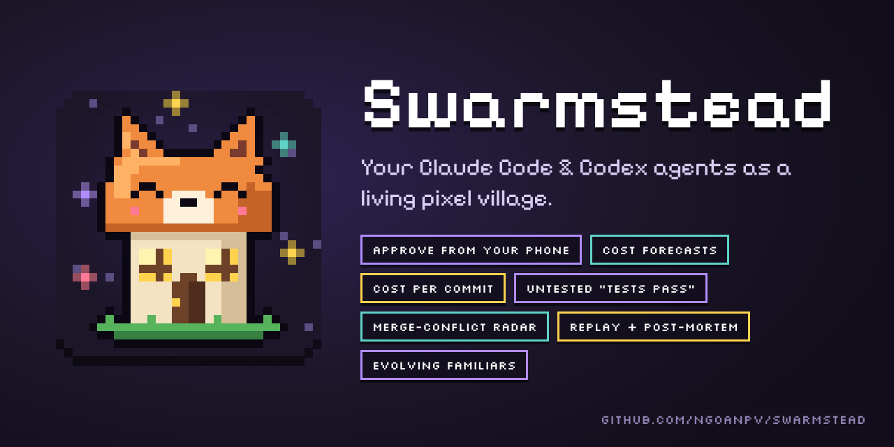
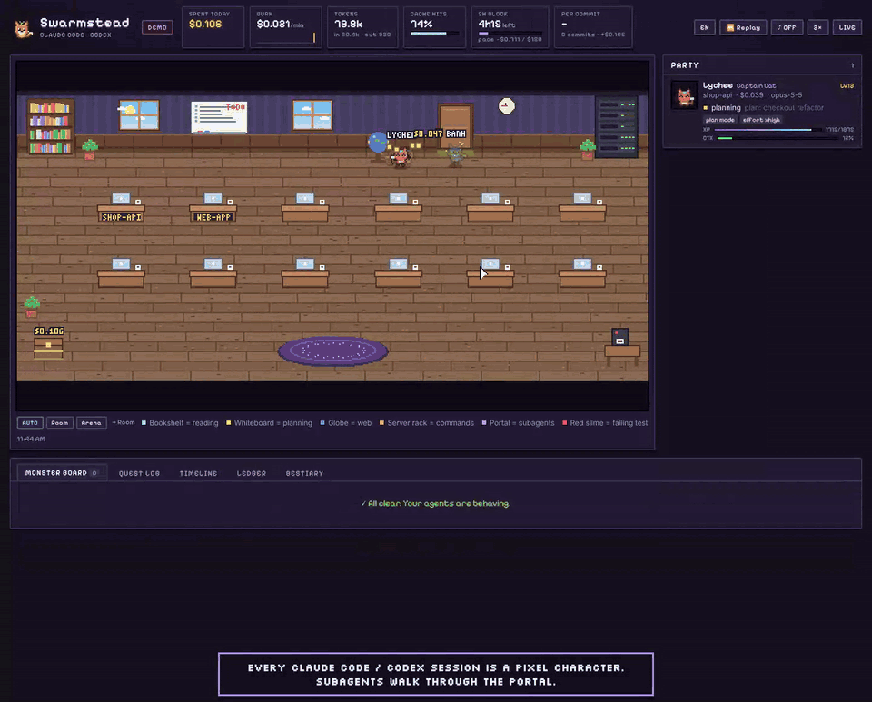
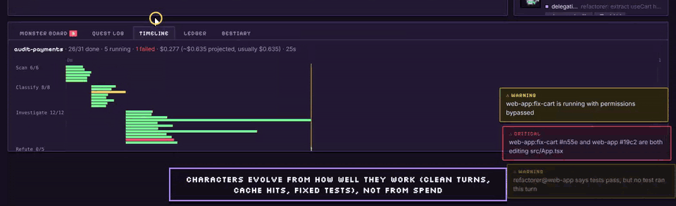
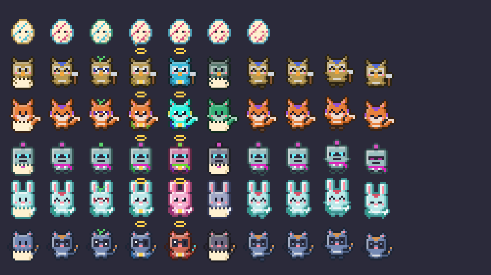
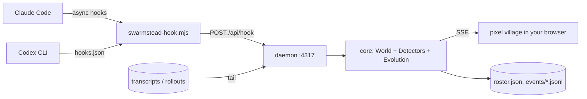

<p align="center">
  
</p>

<p align="center">
  <a href="https://github.com/ngoanpv/swarmstead/actions/workflows/ci.yml"></a>
  <a href="https://www.npmjs.com/package/swarmstead"></a>
  <a href="LICENSE"></a>
  
  
  <a href="https://ngoanpv.github.io/swarmstead/"></a>
</p>

**Watch your coding agents work as a living pixel village.** Every Claude Code session moves into the workshop as a little character. Subagents step out of a portal, carry scrolls back to their lead, and fight bug monsters when tests fail. Coins fly into a treasure chest as tokens are spent. When something goes wrong (a loop, a stuck permission prompt, context about to overflow, two agents editing the same file), you see it before it costs you.

And the villagers **evolve**, but only through good habits: finished work, few loops, and spending less than their own average.



**[▶ Play the live demo](https://ngoanpv.github.io/swarmstead/)** (runs in your browser, no install; also [hosted on Claude](https://claude.ai/artifact/8HT8mz3i3xZLV7m8iDTe7J)) · **[Watch the 1-minute feature tour (MP4)](docs/media/swarmstead-tour.mp4)**

> Claude Code first. Codex CLI support is in **beta**. Local-only, zero runtime dependencies, MIT licensed.

**Install:** `claude plugin marketplace add ngoanpv/swarmstead` and `claude plugin install swarmstead@swarmstead`, start a new Claude Code session, then open http://127.0.0.1:4317/web/. [More ways ↓](#install)

**What it does for you every day**

| | Feature | |
|---|---|---|
| 1 | **Answer permission prompts from the village or your phone**, so a background subagent never hangs on a prompt nobody sees | [↓](#1-approve-from-the-village-or-your-phone) |
| 2 | **Forecasts**: what this workflow will cost (from your past runs), and whether you hit your 5-hour block or Codex limit before it resets, plus an optional budget brake | [↓](#2-forecasts-and-the-budget-brake) |
| 3 | **"All tests pass", checked**: flags an agent that claims success without a passing test after its last edit | [↓](#3-and-4-claims-that-were-never-tested-and-merge-conflicts-before-they-happen) |
| 4 | **Merge-conflict forecast** across git worktrees: the same file changed in two trees | [↓](#3-and-4-claims-that-were-never-tested-and-merge-conflicts-before-they-happen) |
| 5 | **Cost per commit and per PR**, per project | [↓](#5-cost-per-commit-and-per-pr) |
| 6 | **Replay any day** and get a **post-mortem**: where the money went, what was wasted, shareable as Markdown | [↓](#6-replay-and-post-mortem) |

---

## Why

Running agents in parallel creates new problems, and terminal scrollback hides most of them:

| Pain | What usually happens | What the village shows |
|---|---|---|
| A background subagent waits on a permission prompt nobody sees | It hangs silently and you re-run it | A frozen villager with a red `!` and a **critical** alert |
| The agent loops: the same grep, the same failing fix | Tokens burn until you notice | Dizzy stars, a red ring, a "going in circles" alert |
| Context fills up and auto-compacts while subagents report back | Their results get summarised away | An HP bar over each head, and a "compacted during handoff" warning |
| Two sessions edit the same file | The last write wins and work disappears silently | Lightning between the two villagers, and a collision alert |
| Cost is invisible until the bill arrives | `/cost` only shows one session | A live treasury, burn rate, cache-hit ratio, 5-hour block |
| A workflow fans out to dozens of agents | `/workflows` shows counts per stage, nothing more | An **Arena** with one pad per stage, squads instead of crowds, stragglers called out, and a timeline |
| Results come back and you can't tell which ones went wrong | One merged summary | Each report arrives as a scroll colored by how it went: clean, rough, failed, or maybe lost to compaction |
| Waiting is boring | You tab away and forget the agent needs you | Villagers walk to the coffee machine when they're waiting for you |
| You have to be at the terminal to approve | Agents sit idle while you're away | Approve / Deny in the village, or from a push notification on your phone |
| "Will this run blow my limit?" | You find out when it stops | A cost forecast per run, a 5-hour block pace, a Codex limit ETA, and an optional brake |
| "All tests pass ✅" | You trust it, then CI fails | A `claims tests pass, but no test ran` warning |
| Parallel worktrees | Conflicts show up at merge time | A merge-risk warning as soon as both trees touch the same file |
| "Was that worth it?" | Nobody knows what a change cost | Cost per commit and per PR |
| "Why did today cost $40?" | Scrollback is gone | Replay and a post-mortem with the waste broken out |

## Install

Requires **Node 18+** and Claude Code.

**1. Install the plugin** (in a terminal, or with `/plugin marketplace add …` and `/plugin install …` inside Claude Code):

```bash
claude plugin marketplace add ngoanpv/swarmstead
claude plugin install swarmstead@swarmstead
```

**2. Start a new Claude Code session.** The plugin starts the village in the background (the first time takes a few seconds while npm fetches it). Later sessions reuse it.

**3. Open http://127.0.0.1:4317/web/.** Your session walks in through the door as a villager.

Nothing there? Run `npx swarmstead doctor` to check the setup, or `npx swarmstead ping` to send a fake session through.

**Just want to look?** Run `npx swarmstead start --open` and add `?demo` to the address for a scripted day in the village (`&hour=22` for night mode, `&lang=vi` for Vietnamese). Or play the [live demo](https://ngoanpv.github.io/swarmstead/) without installing anything.

### Everyday use

| To | Do |
|---|---|
| Open the village | http://127.0.0.1:4317/web/ |
| Check the setup | `npx swarmstead doctor` |
| Update | `claude plugin update swarmstead@swarmstead`. Third-party plugins don't update on their own; you can turn on auto-update in `/plugin` > Marketplaces. |
| Find out why the village didn't start | Read `~/.swarmstead/daemon.log` |
| Run the daemon yourself | Set `"autostart": false` in `~/.swarmstead/config.json`, then `npx swarmstead start` |
| Uninstall | `claude plugin uninstall swarmstead@swarmstead`. Your config and event log stay in `~/.swarmstead/`; delete it if you want them gone. |

### Without the plugin

Plain hooks in `~/.claude/settings.json` work too, and the approval gate below needs them:

```bash
npx swarmstead install claude      # --project: only this repo's .claude/settings.local.json
npx swarmstead start --open        # keep it running while you work
```

Use the plugin **or** these hooks, not both: with both, every event is counted twice. Update with `npx swarmstead@latest install claude` (plain `npx swarmstead` can reuse an older cached copy). Remove with `npx swarmstead uninstall claude`.

### Optional extras

```bash
npx swarmstead install claude --gate   # hooks only: approve prompts from the village/phone + budget brake
npx swarmstead install git             # inside a repo: book your own commits too (cost per commit)
npx swarmstead start --lan             # reach the village (and approve) from your phone
```

With the plugin, set `"lan": true` in `~/.swarmstead/config.json` instead of `--lan`. It applies the next time the daemon starts.

### Codex CLI (beta)

```bash
npx swarmstead install codex     # writes ~/.codex/hooks.json
```

Codex only runs hooks you have trusted. Open Codex, run `/hooks`, and trust the swarmstead entries. Token usage and rate limits come from `~/.codex/sessions/**/rollout-*.jsonl`.

### From source

`git clone https://github.com/ngoanpv/swarmstead && cd swarmstead && npm run dev` runs the daemon and restarts it on every save. Connect Claude Code with `node bin/swarmstead.js install claude`, or load the plugin for one session with `claude --plugin-dir ./plugin`. Build the single-file demo with `npm i --no-save esbuild && npm run build:demo` (writes `dist/swarmstead-demo.html`). See [CONTRIBUTING.md](CONTRIBUTING.md).

## What you're looking at


| In the village | Means |
|---|---|
| Villager at its **desk** | Writing code or thinking. A typing glow means edits are happening. |
| **Bookshelf** / **whiteboard** / **globe** / **server rack** | Reading or searching / planning / web / running commands |
| **Portal** on the rug | Subagents arrive and leave here |
| Flying **scroll**, gold | A task handed to a subagent |
| Subagent walks back, hands over a **scroll** | Its report. Several returning at once form a queue; the orchestrator reads each one. |
| Scroll color | 🟩 clean · 🟨 rough (loops, failed runs, denials) · 🟥 failed (open bug, API error) · 🟪 maybe lost (orchestrator compacted while it came back) |
| 📜 `3/5` over an orchestrator | Reports received out of all delegated in this fan-out |
| Scrolls spiral into a glowing **tome** | Fan-in: every subagent of the run has reported back |
| `×N` after a name, two shadow copies | A **squad**: N same-stage agents folded together (agents with alerts always step out) |
| Faint afterimages | Several tool calls running in parallel |
| Small gray orbs at the feet | Background tasks still running after the turn |
| Badge left of the name | Permission mode: `P` plan · `E` accept edits · `A` auto · `D` don't ask · blinking `!` bypass permissions |
| Slumped villager with `!!` | Rate limit, overload or billing stop ("out of stamina") |
| Green desk plate | The session works in a git worktree (named on the plate) |
| Gold dotted rope and flag | Agent-team teammates tied to their lead |
| **Red slime** | A test or build failed. It's defeated when the same kind of command passes again. |
| **Coins → chest** | Spend, priced per model, including cache reads and writes |
| **HP bar** over the head | Context remaining. Yellow means you should plan a compaction; red means compaction is imminent. |
| `!` `?` `…` `ZZ` bubbles | Needs approval · waiting for you · thinking · compacting |
| Red/yellow ring, dizzy stars, sweat drop | Active alert (see the Monster board) |
| **Coffee machine** | The agent has been waiting for you for over 45 seconds |
| Room lighting | Follows your local time; lamps and laptops glow at night |

## Big runs: squads, the Arena and the Timeline

Claude Code workflows can launch hundreds of agents (16 at a time by default). Swarmstead changes how it draws them as the swarm grows:

| Agents under one orchestrator | View |
|---|---|
| up to 8 | every subagent is its own villager |
| more than 8 | same-stage agents fold into **squads** (`×N`); the side panel shows one row per stage |
| a run of 12+ | the view switches to the **Arena** automatically: one pad per stage along a path, a progress ring, a pile of finished reports and tombstones for failures, the orchestrator on a dais with its inbox, and the final tome at the end |


The **Timeline** tab draws one swimlane per stage, with a bar per agent colored by outcome. Stragglers still running at 3× their stage's median get a red outline. Use the `Auto / Room / Arena` switch under the stage to pick a view yourself.


How a run is recognised:
- Every subagent launched by the same orchestrator joins its current **run** until 15 s pass with nothing running.
- For workflows, the run name comes from the `Workflow` tool result and `<session>/workflows/scripts/<name>-<runId>.js`.
- Each agent's **phase** (stage) comes from `<session>/subagents/workflows/<runId>/journal.jsonl`.
- Plain fan-outs use the subagent type as the stage.

## The daily tools

### 1. Approve from the village or your phone


Install the **gate** (opt-in): `npx swarmstead install claude --gate`. When a Claude Code permission prompt fires, it shows up in the **Needs your approval** panel with **Approve**, **Allow for session** and **Deny**.

- **Subagent** prompts wait up to `gate.waitSubSec` (120 s) for your answer. Main-session prompts are not held by default (`waitMainSec: 0`), so your terminal never waits on Swarmstead.
- No answer, the village closed, or Swarmstead not running: the gate prints nothing and Claude Code shows its normal prompt. It always fails open.
- **Phone:** add `"notify": { "ntfy": "https://ntfy.sh/<long-secret-topic>", "publicUrl": "http://<your-computer-ip>:4317" }` and start with `--lan`. Approval pushes then carry **Approve / Deny** buttons that work from the lock screen. Slack/Discord webhooks and desktop notifications are supported too (`server/notify.js`).
- Deciding needs the token in `~/.swarmstead/token`. The local page fetches it; your phone gets it from the link the daemon prints in LAN mode.

### 2. Forecasts and the budget brake

- **Per run:** when a workflow starts, Swarmstead compares it with your past runs of the same workflow (`~/.swarmstead/runs.jsonl`): "usually $0.62 (4 runs)". The Arena header shows `EST $X` and the time left; the Timeline header shows the projection. Without history it extrapolates from the agents that have already finished.
- **5-hour block:** the header shows your pace to the end of the block. Set `"limits": { "claudeBlockUsd": 150 }` and you are warned when you will reach it before the block resets.
- **Codex:** the rate-limit percentage Codex reports is turned into "limit in 18 min, resets in 2 h".
- **Brake (opt-in):** with the gate installed and `"gate": { "brakes": true }`, new subagents are refused once `dailyBudgetUsd` or `runBudgetUsd` is reached, with a reason Claude can read ("finish with what you have").

### 3 and 4. Claims that were never tested, and merge conflicts before they happen


- When an agent's final message claims tests, the build or lint pass, Swarmstead checks that a test command **passed after the agent's last edit** in that turn. If not, you get `refactorer@web-app says tests pass, but no test ran this turn`, a `?` over its head, and a rough outcome. Only the true/false result is kept, never the message.
- When the same file (by path inside the repo) is edited in two git worktrees, or in a worktree and the main checkout, within 24 hours, you get `fix-cart and main both changed src/App.tsx: expect a merge conflict`, and a dashed line connects the two agents.

### 5. Cost per commit and per PR


Agent runs of `git commit`, `gh pr create` and `gh pr merge` are recognised from their commands. Run `npx swarmstead install git` inside a repo to count your own commits too (a `post-commit` hook that sends only the repo path and the hash). Everything spent on a project since its previous commit is booked against the next one. The **Ledger** tab shows spend, commits, cost per commit, PRs and cost per PR, and what is "not yet committed". The header shows today's cost per commit.

### 6. Replay and post-mortem


Click **Replay** to play back any day from `~/.swarmstead/events/` at 1× to 120×, with every animation, and drag the scrubber to jump. **Post-mortem** answers "why did this cost $40?":

- spend by **activity** (what agents were doing when they spent), project, agent type and model
- **waste**: spend while an agent was looping, stalled or repeating the same error
- the most expensive turns, every incident, runs and commits
- **Copy as Markdown** to paste into a PR, an issue or Slack

**Export** saves the day as JSON; drop that file onto any Swarmstead page (including the hosted demo) to replay it on another machine.

## Issue detectors

All of these run locally in `core/detectors.js`, and every threshold can be changed in `~/.swarmstead/config.json`.

| Detector | Fires when (defaults) | Severity |
|---|---|---|
| `loop` | Same tool + same input ≥3× in the last 8 calls | warn (≥5 → crit) |
| `errorEcho` | Same normalised error message ≥3× in 10 min | warn |
| `stall` | ≥25 tool calls, ≥10 min, ≥$0.50 spent with no file edits (not for read-only roles) | warn |
| `context` | Context ≥65% full | warn (≥80% → crit) |
| `permission` | Main agent blocked on approval >20 s | warn |
| `permissionSub` | A **subagent** blocked on approval | crit |
| `waiting` | Main agent idle, waiting for you >3 min | info |
| `burn` | 5-min average ≥ $1/min | warn (3× → crit) |
| `budget` | Today's spend ≥ `dailyBudgetUsd` (off by default) | crit |
| `collision` | Two unrelated sessions edit the same file within 10 min | crit |
| `compactRisk` | Auto-compaction while subagents are running or just reported back | warn |
| `exhausted` | Turn stopped by `rate_limit`, `overloaded`, `billing_error` or `account_on_hold` | crit (warn for subagents) |
| `bypass` | Session running with `bypassPermissions` | warn |
| `straggler` | A run agent has been working >3× its stage's median and >2 min | warn |
| `sprawl` | A run reaches 50 agents, or spawns ≥20 per minute | info / warn |
| `runBudget` | A run's cost ≥ `runBudgetUsd` (off by default) | crit |
| `runForecast` / `runOverrun` | A run is projected over `runBudgetUsd`, or has cost 1.5× its usual | warn |
| `blockForecast` | At this pace you reach `limits.claudeBlockUsd` before the 5-hour block resets, or beat your heaviest block | warn / info |
| `limitForecast` | A provider limit (Codex) runs out before it resets | warn (<30 min → crit) |
| `unverified` | An agent claims tests pass without a passing test after its last edit | warn |
| `mergeRisk` | The same repo file edited in two worktrees within 24 h | warn |

**Swarm collapse:** when 3 or more subagents of one orchestrator trip the same rule, you get one alert ("7 subagents of payments are stuck on permission prompts") instead of seven.

Every alert comes with a one-line hint on what to do next.

## Evolution

Each **agent identity** (provider + project + agent type, e.g. `claude:shop-api:code-reviewer`) owns a *familiar* that persists across sessions in `~/.swarmstead/roster.json`.

```
xp per finished turn = 10 × work × quality × thrift × cache  +  15 × bugs slain  +  clean bonus
```

- **work**: edits, runs and delegations, capped. Busywork cannot farm XP.
- **quality**: penalised by loops, repeated errors and forced compactions.
- **thrift**: this turn's cost-per-work compared with the familiar's *own* moving average. Spending more never earns more.
- **cache**: a small bonus for good prompt-cache reuse.

**Behaviour decides the species**, and **quality gates decide whether it can evolve**:

| Work style | Species | Egg → Hatchling → Adept → Master (Zen / Alchemist) → Legend |
|---|---|---|
| reading & research | Owl | Hootlet → Scribowl → Sage Owl / Alchemowl → Oracle of Tomes / Golden Grimoire |
| writing code | Fox | Kit → Codefox → Zen Kitsune / Forgefox → Ninetail / Sunforge Kitsune |
| running commands | Bot | Boltling → Gearbot → Zen Golem / Brass Automaton → Synthwarden / Gilded Colossus |
| web & tools | Bunny | Hopper → Scoutbun → Moonhare / Treasure Hare → Star Strider / Comet Hare |
| delegating | Cat | Kitten → Captain Cat → Zen Sphinx / Merchant Lion → Celestial Sphinx / Sun King |

**Swarms can't farm XP.** A subagent's XP is multiplied by √(4 / swarm size) once a run has more than 4 agents. The orchestrator instead gets one **fan-in bonus** when the whole run has reported back: 20 × √agents (capped at 10) × the run's success rate.

Master requires **Focus ≥ 55**, so a loopy agent stays Adept forever. Legend requires a **10-turn clean streak**. A clean streak also makes a familiar **shiny**. Loops leave a visible **glitch** that heals with clean turns. Details and tuning are in [docs/EVOLUTION.md](docs/EVOLUTION.md).





Every sprite is generated procedurally from a genome (no image assets), so the project needs no paid tilesets and every familiar looks different.

## Claude Code coverage

| Signal | Source | Shown as |
|---|---|---|
| Session start / resume / fork / end, prompts, turn end | `SessionStart` `SessionEnd` `UserPromptSubmit` `Stop` | arrival at the door, "RESUMED"/"FORKED", ✓ bubble, XP |
| Every tool call, success or failure, interrupts | `PreToolUse` `PostToolUse` `PostToolUseFailure` | walking to stations, bug monsters, loop/error detectors |
| Parallel tool calls | overlapping `PreToolUse` | afterimages, `×N` |
| Permission prompts and denials | `PermissionRequest` `Notification:permission_prompt` `PermissionDenied` | `!` bubble, raised hand, ✕ bubble |
| Waiting for you, MCP elicitation | `Notification:idle_prompt` `Elicitation` | `?` bubble, coffee machine |
| API failures | `StopFailure` | "out of stamina" |
| Subagents, nested subagents | `SubagentStart` / `SubagentStop` with `agent_id`, plus `agent-*.meta.json` | portal, scrolls, queue, outcomes |
| Workflows | `Workflow` tool result, workflow journal and scripts on disk | Arena, stages, timeline |
| Agent teams | `TeammateIdle` `TaskCreated` `TaskCompleted`, `~/.claude/teams/*/config.json` | teammates stay in the room; messages are handoffs |
| Compaction | `PreCompact` `PostCompact` | sleeping villager, `compactRisk` |
| Model switches, permission mode, effort | `PostModelSwitch`, `permission_mode`, `effort.level` on every payload | floater, name badge, side panel |
| Background tasks, crons | `background_tasks` `session_crons` on `Stop` | orbs at the feet |
| Worktrees | worktree paths in `cwd` (`.claude/worktrees/<name>`), `CwdChanged` | green desk plate, no false collisions |
| Tokens, cost, model, context, thinking | transcripts (deduplicated by message id), workflow agent transcripts | coins, HP bar, totals |
| Permission decisions (opt-in gate) | synchronous `PermissionRequest` hook, `PreToolUse` on `Agent\|Task\|Workflow` | approvals panel, phone pushes, budget brake |
| "Tests pass" claims | `last_assistant_message` on `Stop` / `SubagentStop` (only a boolean is kept) | `unverified` |
| Commits and PRs | agent `git commit` / `gh pr` commands, optional git `post-commit` hook | Ledger, gold parcel |

Swarmstead **never** registers `WorktreeCreate`, `WorktreeRemove` or `PreModelSwitch`. Registering a `WorktreeCreate` hook replaces Claude Code's own git-worktree creation, and the other two can change behaviour too, so `npm test` checks that they stay out.

## How it works



- **Hooks** give accurate state: tool start and end, permission prompts, subagent start and stop, compaction, turn end. They're registered with `async: true`, never print, and always exit 0, so they cannot slow down or change your agent. The only exception is the **gate**, which you add on purpose with `--gate`: it is synchronous so it can return your decision, and it fails open.
- **Transcripts** give tokens, model, and context size (Claude Code `~/.claude/projects/**.jsonl`, deduplicated by message id; Codex rollouts).
- **core/** is plain ES modules shared by the daemon and the browser. The demo runs the same engine in the page.

More in [docs/ARCHITECTURE.md](docs/ARCHITECTURE.md). The event schema and how to feed events from your own tools are in [docs/EVENTS.md](docs/EVENTS.md).

## Configuration

`~/.swarmstead/config.json` (every key is optional):

```json
{
  "port": 4317,
  "capture": "summary",
  "thresholds": { "burnUsdPerMin": 2, "dailyBudgetUsd": 30, "runBudgetUsd": 5, "contextWarn": 0.6 },
  "limits": { "claudeBlockUsd": 150 },
  "gate": { "approvals": true, "waitSubSec": 120, "waitMainSec": 0, "brakes": false },
  "notify": { "desktop": true, "ntfy": "https://ntfy.sh/<long-secret-topic>", "publicUrl": "http://192.168.1.20:4317" },
  "lan": false,
  "autostart": true,
  "pricing": { "my-proxy-model": { "input": 3, "output": 15, "cacheWrite": 3.75, "cacheRead": 0.3 } }
}
```

Costs are **estimates** computed from public list prices (`core/pricing.js`, checked 2026-10-27). On a Claude or ChatGPT subscription, read them as "API-equivalent" cost. They are still a useful efficiency signal.

## Privacy & security

- Everything stays on your machine. The daemon binds to `127.0.0.1`, rejects cross-origin POSTs and foreign `Host` headers (DNS rebinding), and serves only `web/` and `core/`.
- The state holds **summaries only**: file paths, the first 60 characters of a command, a search query. File contents, diffs, prompts and tool output are never stored. Use `"capture": "minimal"` to keep even less.
- **What can leave your machine**, only if you set it up: push notifications to your ntfy topic (`notify.ntfy`) and messages to a Slack or Discord webhook (`notify.webhook`). Each carries an alert's title and one line of text: the agent, the tool and a short detail. Nothing is ever sent to the Swarmstead author.
- An event log is written to `~/.swarmstead/events/` so you can replay sessions. It stays on your machine until you delete it. Turn it off with `"logEvents": false`.
- The plugin's autostart runs `npx -y swarmstead@<version>` with exactly the version of the plugin you installed. Turn it off with `"autostart": false` and run the daemon yourself.
- Deciding an approval always needs the token in `~/.swarmstead/token` (created with mode 0600). With `--lan`, every API call from another device needs it too. Use a long, secret ntfy topic: anyone who knows the topic can read the pushes.

## Roadmap

- [x] Replay mode and post-mortem
- [x] Cost per commit / PR, using agent git commands and a git hook
- [x] Approvals from the village and the phone, budget brake
- [ ] Live workflow progress from the SDK's `task_progress` stream (queued agents, retries)
- [ ] Split-pane agent-team teammates (separate sessions) linked to their lead
- [ ] Cost per *merged* PR via the GitHub API
- [ ] VS Code panel and menubar mini-village
- [ ] Gemini CLI / OpenCode adapters
- [ ] Community sprite packs, as long as they are under a free licence

## Contributing

PRs are welcome, especially new detectors, adapters, sprites and translations. See [CONTRIBUTING.md](CONTRIBUTING.md). Run `npm test` before you open a PR.

## Logo

<p>
  
  
  
</p>

A fox-eared cottage (the *stead*) with glowing window eyes, and a few sparks around it (the *swarm*). It is pixel art on a 32×32 grid, so scale it by whole numbers with nearest-neighbour filtering (`image-rendering: pixelated`).

| File | Use |
|---|---|
| [`docs/brand/icon.svg`](docs/brand/icon.svg) | Vector, any size |
| [`docs/brand/icon-512.png`](docs/brand/icon-512.png) · [`256`](docs/brand/icon-256.png) · [`64`](docs/brand/icon-64.png) · [`32`](docs/brand/icon-32.png) | App icons, avatars, favicons |
| [`docs/brand/social-preview.png`](docs/brand/social-preview.png) | 1280×640 banner: README header and GitHub social preview |

Regenerate them with `python3 scripts/brand/make-icon.py` (needs Pillow). The logo is under the same MIT licence as the code.

## Credits & license

MIT © [ngoanpv](https://github.com/ngoanpv) and Swarmstead contributors. Fonts: [Pixelify Sans](https://github.com/eifetx/Pixelify-Sans) and [Silkscreen](https://kottke.org/plus/type/silkscreen/), both under the SIL Open Font License (see `web/fonts/`). Inspired by the community's pixel-office and observability experiments around Claude Code.

---

### 🇻🇳 Tóm tắt tiếng Việt

**Swarmstead** biến các phiên Claude Code (và Codex, bản beta) thành một ngôi làng pixel sống động:

- Mỗi agent là một nhân vật. Subagent bước ra từ cổng phép, làm việc, rồi mang cuộn giấy về báo cáo cho agent chính.
- Test fail thì quái vật xuất hiện. Token tiêu đến đâu, đồng xu bay vào rương đến đó.
- Hệ thống tự phát hiện: lặp vòng, kẹt chờ duyệt quyền (nhất là subagent chạy nền), context sắp đầy, hai agent sửa cùng một file, tốc độ đốt tiền cao.
- **Tiến hoá nhân vật**: XP chỉ đến từ lượt làm việc đã hoàn thành, tính theo khối lượng × chất lượng × tiết kiệm × cache. Thói quen làm việc quyết định loài: đọc → Cú, viết → Cáo, chạy lệnh → Robot, web → Thỏ, giao việc → Mèo.
- Lặp vòng làm nhân vật bị "glitch". Mười lượt sạch liên tiếp sẽ thành **SHINY**.
- Khi subagent xong việc, nó đi về bàn agent điều phối, xếp hàng và trao cuộn giấy. Màu cuộn giấy cho biết kết quả: xanh là sạch, vàng là trục trặc, đỏ là thất bại, tím là có thể mất do nén context. Khi đủ báo cáo, các cuộn giấy gộp thành một cuốn sách phát sáng.
- Workflow lớn (hàng chục đến hàng trăm agent) chuyển sang **Đấu trường**: mỗi giai đoạn một bệ, agent cùng giai đoạn gộp thành đội ×N, và tab **Dòng thời gian** chỉ ra agent chậm bất thường.

- **Duyệt quyền từ làng hoặc điện thoại** (`install claude --gate`, cấu hình `notify.ntfy`): subagent chạy nền không còn bị kẹt vì không ai thấy hộp thoại.
- **Dự báo**: workflow này sẽ tốn bao nhiêu (so với các lần chạy trước), có chạm trần khối 5 giờ hay hạn mức Codex trước khi reset không, kèm "phanh ngân sách" tuỳ chọn.
- **Bắt lời khai "tests pass"** khi chưa có lần chạy test nào thành công sau lần sửa cuối.
- **Dự báo xung đột merge** giữa các git worktree.
- **Chi phí trên mỗi commit / PR** (tab Ledger, `install git`).
- **Tua lại một ngày** và **post-mortem**: tiền đi đâu, bao nhiêu là lãng phí, chép thành Markdown để chia sẻ.

Cài đặt: chạy `claude plugin marketplace add ngoanpv/swarmstead` rồi `claude plugin install swarmstead@swarmstead`, mở một session Claude Code mới (làng tự khởi động), rồi mở http://127.0.0.1:4317/web/. Kiểm tra bằng `npx swarmstead doctor`, cập nhật bằng `claude plugin update swarmstead@swarmstead`. Chỉ muốn xem thử: `npx swarmstead start --open` rồi thêm `?demo&lang=vi`, hoặc mở [bản demo trực tuyến](https://ngoanpv.github.io/swarmstead/).
