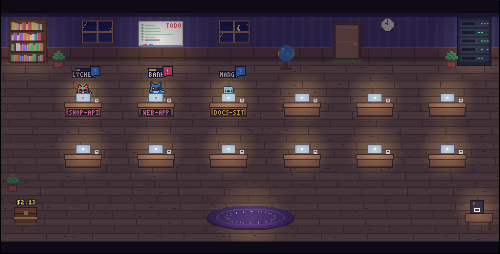
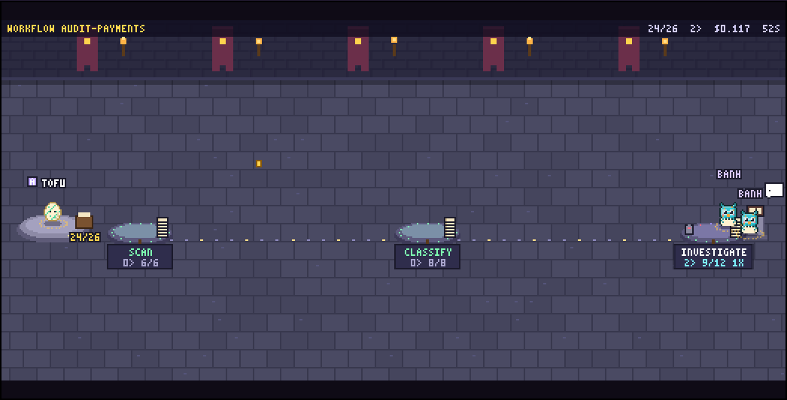
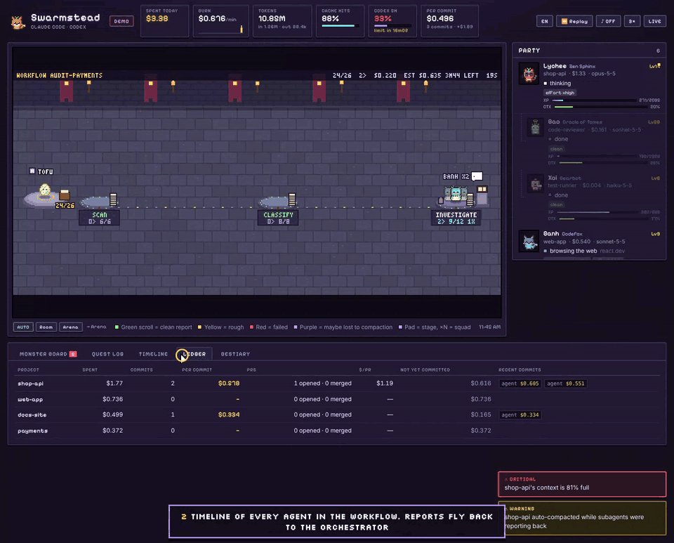
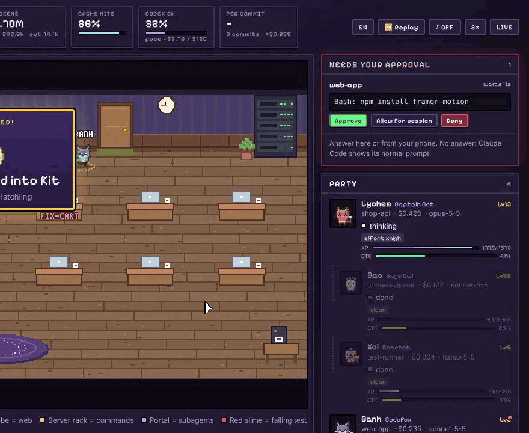
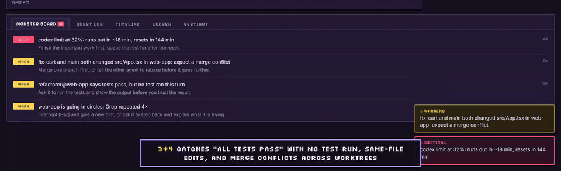
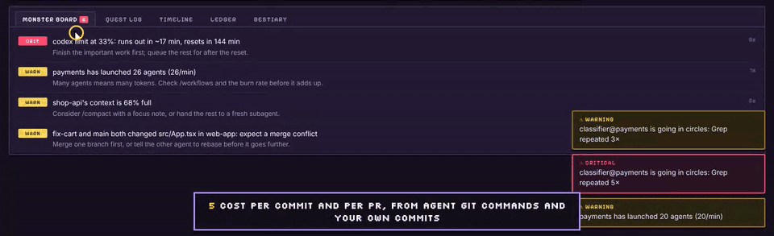
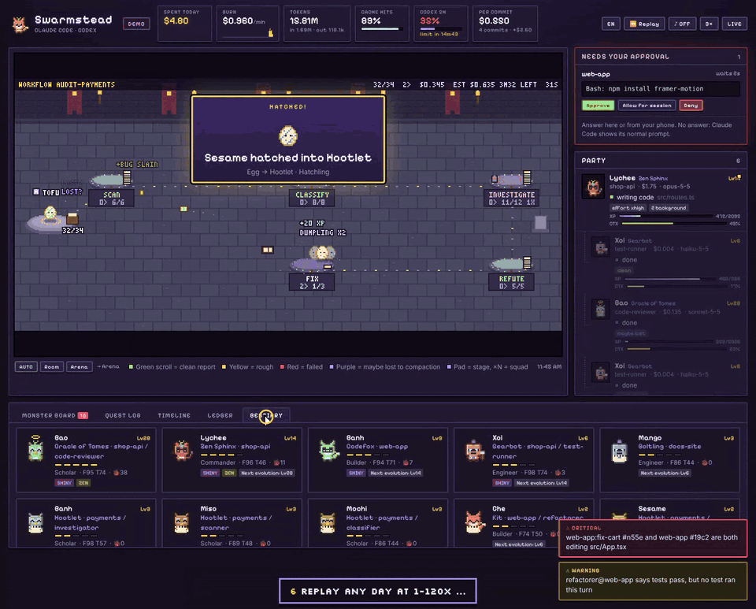

# Features

What Swarmstead shows you, and the six tools you will use every day. To install it, see the [README](../README.md#install).

## Why

Running agents in parallel creates new problems, and terminal scrollback hides most of them:

| Pain | What usually happens | What the village shows |
|---|---|---|
| A background subagent waits on a permission prompt nobody sees | It hangs silently and you re-run it | A frozen villager with a red `!` and a **critical** alert |
| The agent loops: the same grep, the same failing fix | Tokens burn until you notice | Dizzy stars, a red ring, a "going in circles" alert |
| Context fills up and auto-compacts while subagents report back | Their results get summarised away | An HP bar over each head, and a "compacted during handoff" warning |
| Two sessions edit the same file | The last write wins and work disappears silently | Lightning between the two villagers, and a collision alert |
| Cost is invisible until the bill arrives | `/cost` only shows one session | A live treasury, burn rate, cache-hit ratio, 5-hour block |
| A workflow fans out to dozens of agents | `/workflows` shows counts per stage, nothing more | An **Arena** with one pad per stage, squads instead of crowds, stragglers called out, and a timeline |
| Results come back and you can't tell which ones went wrong | One merged summary | Each report arrives as a scroll colored by how it went: clean, rough, failed, or maybe lost to compaction |
| Waiting is boring | You tab away and forget the agent needs you | Villagers walk to the coffee machine when they're waiting for you |
| You have to be at the terminal to approve | Agents sit idle while you're away | Approve / Deny in the village, or from a push notification on your phone |
| "Will this run blow my limit?" | You find out when it stops | A cost forecast per run, a 5-hour block pace, a Codex limit ETA, and an optional brake |
| "All tests pass ✅" | You trust it, then CI fails | A `claims tests pass, but no test ran` warning |
| Parallel worktrees | Conflicts show up at merge time | A merge-risk warning as soon as both trees touch the same file |
| "Was that worth it?" | Nobody knows what a change cost | Cost per commit and per PR |
| "Why did today cost $40?" | Scrollback is gone | Replay and a post-mortem with the waste broken out |

## What you're looking at

| In the village | Means |
|---|---|
| Villager at its **desk** | Writing code or thinking. A typing glow means edits are happening. |
| **Bookshelf** / **whiteboard** / **globe** / **server rack** | Reading or searching / planning / web / running commands |
| **Portal** on the rug | Subagents arrive and leave here |
| Flying **scroll**, gold | A task handed to a subagent |
| Subagent walks back, hands over a **scroll** | Its report. Several returning at once form a queue; the orchestrator reads each one. |
| Scroll color | 🟩 clean · 🟨 rough (loops, failed runs, denials) · 🟥 failed (open bug, API error) · 🟪 maybe lost (orchestrator compacted while it came back) |
| 📜 `3/5` over an orchestrator | Reports received out of all delegated in this fan-out |
| Scrolls spiral into a glowing **tome** | Fan-in: every subagent of the run has reported back |
| `×N` after a name, two shadow copies | A **squad**: N same-stage agents folded together (agents with alerts always step out) |
| Faint afterimages | Several tool calls running in parallel |
| Small gray orbs at the feet | Background tasks still running after the turn |
| Badge left of the name | Permission mode: `P` plan · `E` accept edits · `A` auto · `D` don't ask · blinking `!` bypass permissions |
| Slumped villager with `!!` | Rate limit, overload or billing stop ("out of stamina") |
| Green desk plate | The session works in a git worktree (named on the plate) |
| Gold dotted rope and flag | Agent-team teammates tied to their lead |
| **Red slime** | A test or build failed. It's defeated when the same kind of command passes again. |
| **Coins → chest** | Spend, priced per model, including cache reads and writes |
| **HP bar** over the head | Context remaining. Yellow means you should plan a compaction; red means compaction is imminent. |
| `!` `?` `…` `ZZ` bubbles | Needs approval · waiting for you · thinking · compacting |
| Red/yellow ring, dizzy stars, sweat drop | Active alert (see the Monster board) |
| **Coffee machine** | The agent has been waiting for you for over 45 seconds |
| Room lighting | Follows your local time; lamps and laptops glow at night |

## Big runs: squads, the Arena and the Timeline

Claude Code workflows can launch hundreds of agents (16 at a time by default). Swarmstead changes how it draws them as the swarm grows:

| Agents under one orchestrator | View |
|---|---|
| up to 8 | every subagent is its own villager |
| more than 8 | same-stage agents fold into **squads** (`×N`); the side panel shows one row per stage |
| a run of 12+ | the view switches to the **Arena** automatically: one pad per stage along a path, a progress ring, a pile of finished reports and tombstones for failures, the orchestrator on a dais with its inbox, and the final tome at the end |

The **Timeline** tab draws one swimlane per stage, with a bar per agent colored by outcome. Stragglers still running at 3× their stage's median get a red outline. Use the `Auto / Room / Arena` switch under the stage to pick a view yourself.

How a run is recognised:
- Every subagent launched by the same orchestrator joins its current **run** until 15 s pass with nothing running.
- For workflows, the run name comes from the `Workflow` tool result and `<session>/workflows/scripts/<name>-<runId>.js`.
- Each agent's **phase** (stage) comes from `<session>/subagents/workflows/<runId>/journal.jsonl`.
- Plain fan-outs use the subagent type as the stage.

## The daily tools

### 1. Approve from the village or your phone

Install the **gate** (opt-in): `npx swarmstead install claude --gate`. When a Claude Code permission prompt fires, it shows up in the **Needs your approval** panel with **Approve**, **Allow for session** and **Deny**.

- **Subagent** prompts wait up to `gate.waitSubSec` (120 s) for your answer. Main-session prompts are not held by default (`waitMainSec: 0`), so your terminal never waits on Swarmstead.
- No answer, the village closed, or Swarmstead not running: the gate prints nothing and Claude Code shows its normal prompt. It always fails open.
- **Phone:** add `"notify": { "ntfy": "https://ntfy.sh/<long-secret-topic>", "publicUrl": "http://<your-computer-ip>:4317" }` and start with `--lan`. Approval pushes then carry **Approve / Deny** buttons that work from the lock screen. Slack/Discord webhooks and desktop notifications are supported too (`server/notify.js`).
- Deciding needs the token in `~/.swarmstead/token`. The local page fetches it; your phone gets it from the link the daemon prints in LAN mode.

### 2. Forecasts and the budget brake

- **Per run:** when a workflow starts, Swarmstead compares it with your past runs of the same workflow (`~/.swarmstead/runs.jsonl`): "usually $0.62 (4 runs)". The Arena header shows `EST $X` and the time left; the Timeline header shows the projection. Without history it extrapolates from the agents that have already finished.
- **5-hour block:** the header shows your pace to the end of the block. Set `"limits": { "claudeBlockUsd": 150 }` and you are warned when you will reach it before the block resets.
- **Codex:** the rate-limit percentage Codex reports is turned into "limit in 18 min, resets in 2 h".
- **Brake (opt-in):** with the gate installed and `"gate": { "brakes": true }`, new subagents are refused once `dailyBudgetUsd` or `runBudgetUsd` is reached, with a reason Claude can read ("finish with what you have").

### 3 and 4. Claims that were never tested, and merge conflicts before they happen

- When an agent's final message claims tests, the build or lint pass, Swarmstead checks that a test command **passed after the agent's last edit** in that turn. If not, you get `refactorer@web-app says tests pass, but no test ran this turn`, a `?` over its head, and a rough outcome. Only the true/false result is kept, never the message.
- When the same file (by path inside the repo) is edited in two git worktrees, or in a worktree and the main checkout, within 24 hours, you get `fix-cart and main both changed src/App.tsx: expect a merge conflict`, and a dashed line connects the two agents.

### 5. Cost per commit and per PR

Agent runs of `git commit`, `gh pr create` and `gh pr merge` are recognised from their commands. Run `npx swarmstead install git` inside a repo to count your own commits too (a `post-commit` hook that sends only the repo path and the hash). Everything spent on a project since its previous commit is booked against the next one. The **Ledger** tab shows spend, commits, cost per commit, PRs and cost per PR, and what is "not yet committed". The header shows today's cost per commit.

### 6. Replay and post-mortem

Click **Replay** to play back any day from `~/.swarmstead/events/` at 1× to 120×, with every animation, and drag the scrubber to jump. **Post-mortem** answers "why did this cost $40?":

- spend by **activity** (what agents were doing when they spent), project, agent type and model
- **waste**: spend while an agent was looping, stalled or repeating the same error
- the most expensive turns, every incident, runs and commits
- **Copy as Markdown** to paste into a PR, an issue or Slack

**Export** saves the day as JSON; drop that file onto any Swarmstead page (including the hosted demo) to replay it on another machine.
